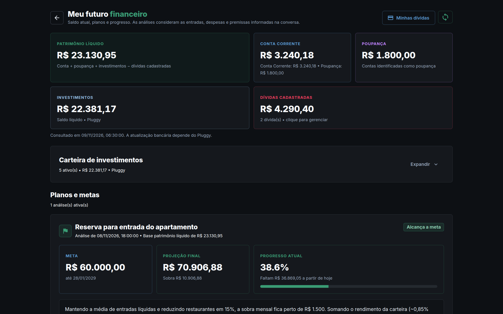
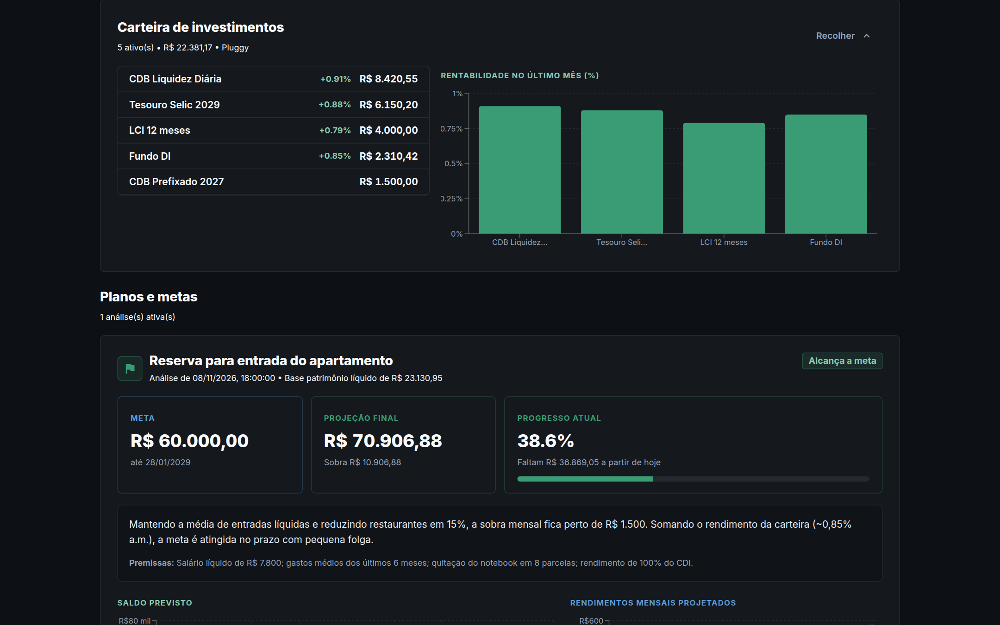
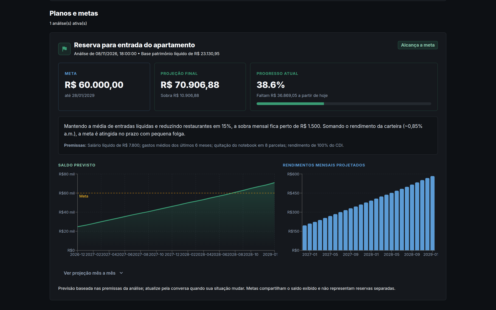
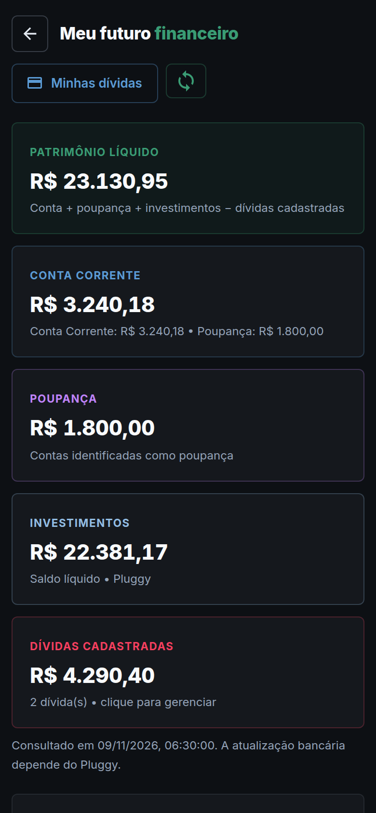

# Finanças Pro

Dashboard pessoal de controle de gastos, com gráficos, metas por categoria e uma **zona de Stage** onde um agente de IA (via **MCP** ou API REST) deposita lançamentos lidos de extratos bancários para revisão e baixa em lote, numa interface de planilha.

Integra-se ao **[Pluggy](https://pluggy.ai)** (Open Finance) para importar transações e consultar saldos e investimentos, e tem a página **Meu futuro financeiro**, com patrimônio líquido, dívidas e **metas financeiras** projetadas mês a mês pelo agente.

> Todos os prints abaixo usam **dados fictícios**.


## Funcionalidades

- **Dashboard**: total do período, categoria com maior gasto, maior compra e navegação por período (mês a mês, "este mês", "30 dias"...).
- **5 visualizações**: radar hexagonal, evolução mês a mês, ranking em barras com orçamento, rosca e cartões/contas.
- **Metas mensais por categoria**: acompanhamento do orçamento.
- **Filtro de categorias**: com todas selecionadas, um clique isola uma categoria; os outros cliques adicionam ou removem. Todas continuam visíveis.
- **Lançamentos**: busca, ordenação, agrupamento por categoria, compras parceladas (`Nome - 1/N` gera as N parcelas) e link para o Google Maps.
- **Stage de extratos (`/stage`)**: planilha editável para revisar o que o agente inferiu.
  - Cabeçalho fixo, largura total, colunas fixas e células obrigatórias vazias destacadas.
  - Navegação por teclado como numa planilha: setas, Enter/F2 para editar, Esc para sair da edição, Tab, Home/End.
  - Ordenação por coluna, seleção de todos / só prontos e preenchimento de categoria/conta em lote.
  - **Dar baixa** em 1 clique, com backup CSV automático antes de gravar.
- **Integração Pluggy (Open Finance)**:
  - **Importar Pluggy** no Stage: traz as compras (débitos confirmados em BRL) da conta conectada para revisão. Cada transação é registrada e nunca é importada duas vezes, mesmo depois da baixa ou do descarte.
  - Saldos de conta corrente, poupança e investimentos consultados em tempo real, com rentabilidade do último mês por ativo.
  - Credenciais ficam só no `.env` do servidor; o navegador nunca fala com o Pluggy.
- **Meu futuro financeiro (`/planejamento`)**:
  - Patrimônio líquido = conta + poupança + investimentos − dívidas cadastradas.
  - **Minhas dívidas**: cadastro manual do saldo devedor (faturas, empréstimos).
  - **Carteira de investimentos** recolhível; ativos com saldo zerado não são exibidos.
  - **Metas financeiras**: o agente (MCP) analisa gastos e saldos e registra uma meta com valor, prazo, premissas e projeção mensal (entradas, saídas, rendimentos e saldo). A página mostra progresso atual, se a projeção alcança a meta, gráficos e tabela mês a mês, e avisa quando as dívidas mudaram desde a análise.
- **Servidor MCP**: ferramentas para listar, adicionar, atualizar e excluir gastos, categorias, contas e itens do Stage, além de `obter_planejamento` e `registrar_previsao_financeira` para as metas.
- **PWA**: instalável no celular, com layout mobile-first.

## Prints

| Gráficos e orçamento | Filtro de categorias |
| --- | --- |
|  |  |

**Lançamentos**


**Stage de extratos: revisão em planilha**


**Stage: ordenação por coluna e edição com autocompletar**


**Meu futuro financeiro: patrimônio, saldos Pluggy e dívidas**



**Carteira de investimentos expandida (rentabilidade do último mês via Pluggy)**



**Meta financeira com projeção mensal registrada pelo agente**



| Mobile: dashboard | Mobile: Stage |
| --- | --- |
|  |  |

<p align="center"></p>

## Stack

| Camada | Tecnologia |
| --- | --- |
| Frontend | React + Vite, Material UI, Recharts, PWA (`vite-plugin-pwa`) |
| Backend | Node.js + Express (`backend/server.js`), PostgreSQL (`pg`) |
| Banco | PostgreSQL 16 (Docker) ou Supabase (`supabase_schema.sql`) |
| Open Finance | [Pluggy](https://docs.pluggy.ai) (contas, transações e investimentos) |
| Agentes | Servidor MCP em Python (`mcp_server.py`) e MCP HTTP/SSE embutido no backend |
| Proxy | Nginx servindo a UI e encaminhando `/api`, `/mcp` e `/sse` na porta 8080 |

## Estrutura

```text
.
├── backend/            # API Express + MCP HTTP (server.js); scripts legados em Python
│   ├── pluggy.js       # Cliente Pluggy: transações, saldos e investimentos
│   ├── plans.js        # Patrimônio, dívidas e metas financeiras
├── frontend/           # React + Vite
│   ├── src/App.jsx     # Dashboard
│   ├── src/StagePage.jsx  # Stage de extratos (planilha)
│   ├── src/PlanningPage.jsx  # Meu futuro financeiro (saldos, dívidas e metas)
│   └── nginx.conf      # Proxy da porta 8080
├── diretrizes/         # Página e JSON com as regras para agentes (porta 8084)
├── mcp_server.py       # Servidor MCP (stdio) que conversa com a API
├── prints/             # Capturas usadas neste README
├── supabase_*.sql      # Esquema e políticas para rodar no Supabase
└── docker-compose.yml
```

## Como executar

### Docker (recomendado)

```bash
cp .env.example .env
docker network create npm_network   # rede externa usada pelo compose (uma vez só)
docker compose up -d --build
```

| Serviço | URL |
| --- | --- |
| UI + API + MCP | http://localhost:8080 (Stage em `/stage`, metas em `/planejamento`) |
| API direta | http://localhost:8000 |
| Diretrizes para agentes | http://localhost:8084 |
| PostgreSQL | `localhost:5433` (usuário/senha `postgres`) |

Comandos úteis:

```bash
docker compose ps                         # status dos containers
docker compose logs -f backend            # logs de um serviço
docker compose up -d --build frontend     # recompila só um serviço
docker compose down                       # para e remove os containers (mantém os dados)
```

> Evite `docker compose down -v`: apaga o volume do PostgreSQL com todos os lançamentos.

### Configurando o Pluggy

1. Crie uma aplicação no [dashboard do Pluggy](https://dashboard.pluggy.ai) e conecte sua conta bancária (isso gera um **Item**).
2. Preencha no `.env` da raiz:

   ```env
   PLUGGY_CLIENT_ID=...
   PLUGGY_CLIENT_SECRET=...
   PLUGGY_ITEM_ID=...
   ```

3. Recrie o backend: `docker compose up -d --build backend`.

Sem essas variáveis o resto do app funciona normalmente; a página de metas mostra os saldos como "Indisponível".

### Desenvolvimento

```bash
# backend
cd backend && npm install && npm run dev        # http://localhost:8000

# frontend
cd frontend && npm install && npm run dev       # http://localhost:5173
```

Em `:5173`, o frontend chama a API em `:8000` automaticamente.

## API e MCP

Principais rotas (também disponíveis em `/mcp/...`):

| Método | Rota | Descrição |
| --- | --- | --- |
| `GET` | `/api/tudo` | Gastos + categorias + contas + metadados |
| `GET/POST` | `/api/gastos` | Lista (`?search=`) / cria gasto (`Nome - 1/N` gera parcelas) |
| `PATCH/DELETE` | `/api/gastos/:id` | Atualiza / exclui |
| `GET` | `/api/metadados` | Categorias, contas, locais e orçamentos |
| `GET` | `/api/exportar` | Backup CSV completo |
| `GET/POST/PATCH/DELETE` | `/api/stage` | Itens em revisão no Stage |
| `POST` | `/api/stage/commit` | Dá baixa nos itens prontos |
| `POST` | `/api/pluggy/sync` | Importa novas compras do Pluggy para o Stage |
| `GET` | `/api/planejamento` | Saldos Pluggy, investimentos, dívidas, patrimônio e metas |
| `POST/DELETE` | `/api/dividas` · `/api/dividas/:id` | Cadastra / remove dívida |

Exemplo de envio de um lote do extrato para o Stage (campos desconhecidos podem ir vazios):

```http
POST /api/stage
Content-Type: application/json

{
  "limpar_anterior": false,
  "itens": [
    {
      "data": "2026-11-02",
      "nome": "",
      "valor": 64.90,
      "tipo": "",
      "conta": "Cartão de Crédito A",
      "texto_extrato": "02/11 PAG*ESTABELEC R$ 64,90",
      "observacao_agente": "Não identifiquei o item nem a categoria"
    }
  ]
}
```

**MCP**: conecte um cliente em `http://<host>:8080/mcp` (Streamable HTTP) ou `http://<host>:8080/sse`, ou rode `python mcp_server.py` via stdio, definindo `FINANCAS_API_URL`. Para criar uma meta, peça ao agente algo como *"Quero juntar R$ 60 mil até janeiro de 2029"*: ele consulta `obter_planejamento` e os gastos e grava a análise com `registrar_previsao_financeira`, que aparece em `/planejamento`. As regras para agentes (por exemplo, backup CSV antes de qualquer alteração e não listar investimentos zerados) estão em `GEMINI.md` e `diretrizes/`.

## Prints

Os prints são gerados com Playwright, interceptando toda a API com dados fictícios. Assim, nenhum dado real aparece nas imagens. Com o app rodando:

```bash
npm i -D playwright && npx playwright install chromium
BASE_URL=http://localhost:8080 node prints/gerar-prints.mjs
```
